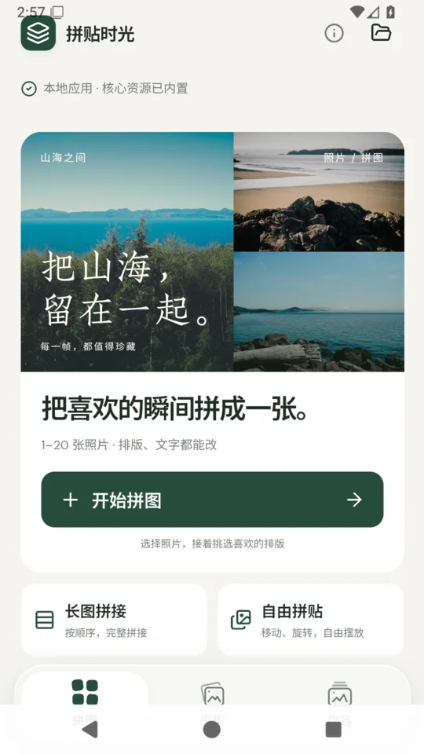
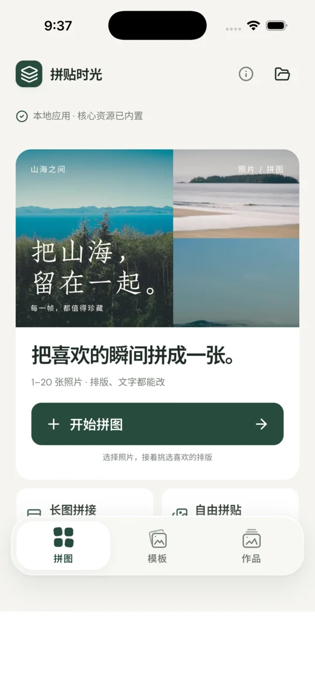
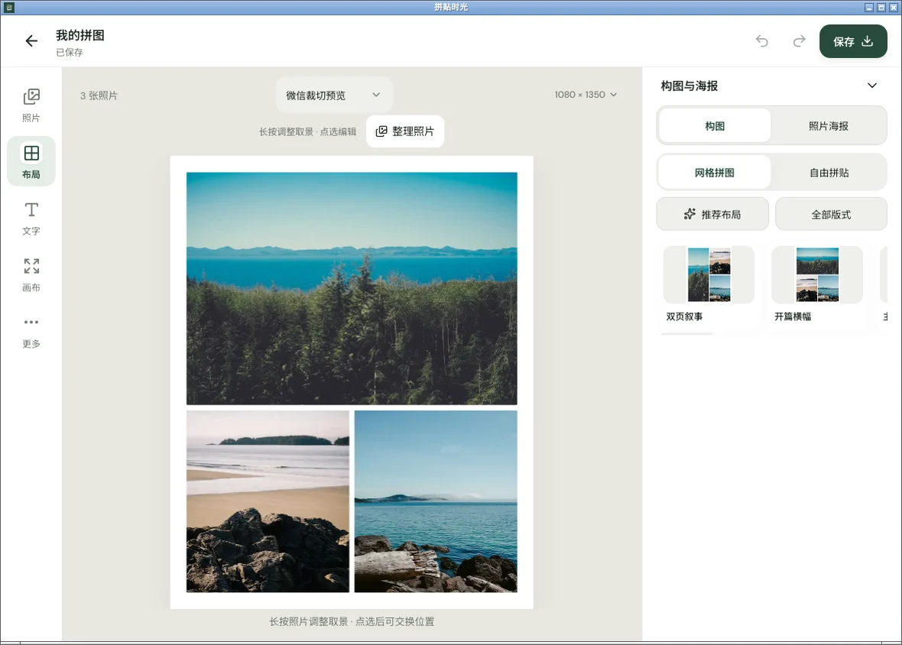

<div align="center">


# 拼贴时光 · Collage Studio

**把喜欢的瞬间，拼成一张。**

一款中文优先的照片拼图与海报编辑器。<br />
把旅行的山海、日常的小事、相聚的合照，做成想分享、想珍藏的作品。

**无需注册 · 照片本地处理 · 高清无水印 · 支持离线**

**[立即开始创作](https://collage.szlh.top/)** · [安装与使用](#快速开始) · [开发与构建](#开发与构建) · [GitHub 源码](https://github.com/jeasoncc/collage-studio)

打开浏览器就能用，也可以安装到主屏幕。

</div>


<p align="center"><sub>三张山海照片，一张属于自己的电影海报。实际 Web 编辑器截图。</sub></p>

## 不止是拼在一起

同一组照片，可以是一张电影海报、一页旅行手帐，也可以是一份节日祝福。选一种喜欢的表达，再换上你的照片和故事。

- **把旅途做成纪念**：山野日记、旅行明信片、胶片照片集，让风景与沿途的小事一起留下。
- **给日常一个封面**：极简拼图、拍立得、手帐与杂志排版，记录周末、朋友和生活里的小确幸。
- **让祝福更有心意**：生日邀请、春节团圆、端午、中秋等节日模板，把合照和想说的话放在一起。
- **珍藏道场相聚**：法会、佛诞、共修、供灯与禅修主题，用朱红、暖金和中文题字记录同行的时刻。

## 好看的排版，也留得下你的想法

### 模板是起点，不是限制

支持 **1–20 张照片**，从规整拼图到主图突出的密集海报，在同一张画布里挑选排版。照片取景、标题文案、配色、间距与圆角都能调整，不必停在模板给出的样子。

照片海报现有 **23 个设计方向**，其中新增 12 款：

- **城市，另一个视角 / 把日常，办成展**：瑞士平面编号与不对称黑体、美术馆展签与宋体细线。
- **出走的一页 / 海风来信**：苔绿旅行手记与路线标记、钴蓝海岸来信与邮戳。
- **今天，值得头条 / 未完待续**：新闻纸双栏头条、带可编辑齿孔与场记标记的胶片样张。
- **此刻，正热烈 / 热爱，永不散场**：酸绿现场节奏、钴蓝运动封面与橙色速度线。
- **快乐，今天加倍 / 以爱，为名**：橘色生日星星与礼物吊牌、象牙白酒红的衬线纪念请柬。
- **今日，有点香 / 和你的小日子**：咖啡收据与杯子图形、蜜桃色陪伴手账与几何爪印。

在「模板」页预览新增款式；已有照片时，进入 **布局 → 照片海报**，按当前 1–20 张照片生成对应版式。预览使用当前照片，取消不改变作品，确认后保留全部照片并可一步撤销。标题、纸块、细线、齿孔、杯子与爪印都能独立编辑；增减照片重新排版时保留已修改的文字与装饰。

设计参考：[Behance 编辑海报系列](https://www.behance.net/gallery/246832989/Editorial-Poster-Series)、[Dribbble 瑞士风格字体海报](https://dribbble.com/shots/16504261-Typography-Posters-Swiss-Style)、[Canva 极简海报指南](https://www.canva.com/learn/minimalist-poster/)、[Adobe Express 海报设计指南](https://www.adobe.com/express/discover/ideas/poster)。借鉴编辑网格、字体对比、信息层级和几何标记，重新设计中文构图；不打包参考站点的原始海报或素材。

### 中文题字，让照片有自己的语气

内置中文字体，搭配标题、题签、贴纸、色块与涂鸦。写一句问候，标记一段旅程，或为自己的照片起一个电影名字；文字与装饰都可以继续编辑。

### 分享作品，不带水印

预览并导出 **PNG / JPG / WebP**，按需要选择清晰度与画质。还可以加入 GIF、视频和背景音乐，在设备支持时导出动态作品。

## 口袋里的拼图工作室

手机竖屏的导出固定在底部右侧，电脑与横屏使用右侧操作栏。「照片、布局、文字、工具」与「导出」在常规编辑中保持稳定；点选照片后的取景、替换等操作浮在画布下方，不再替换常用入口。

正常编辑不再占用整行顶栏。撤销、重做在近期操作时出现，闲置时自动隐藏，显隐不挤动画布；文字输入的键盘态会让出顶部空间。作品名称与保存状态可在「工具与作品」中查看和修改。

撤销、重做保留仍有效的选中对象，文字工具继续保留当前页签和滚动位置，可直接接着修改；对象被移除或跨页时清空失效选中。完成取景后立即恢复撤销入口，闲置仍会隐藏。

手机工具面板统一使用紧凑、展开两档，可点按钮或拖动标题栏切换。拖动时高度跟随手指，松手吸附到对应档位；手势中断恢复原来的档位，展开或收起不主动将内容滚回顶部。首屏直接展示可选版式与海报；「全部版式」「全部海报」「全部风格」在原面板展开，点一次「回到画布」即可继续编辑。窄横屏也先展示紧凑卡片，可在侧栏内展开或收起列表。海报仍需预览并确认替换，保留全部照片，应用后可整步撤销。

在画布上换选照片、文字、形状或涂鸦时，匹配的工具面板会继续保留；图层管理可以连续点选不同类型的对象。换选不匹配的对象时，仍回到画布上的对应操作，不把旧工具留给新对象。

点「取景」后，调整只作用于当前照片；触碰其他照片、文字或装饰不会切换目标或修改它们。「取消」恢复本次取景前的状态，「完成」确认调整。退出取景后，相框仍可直接拖动和缩放；长按临时取景仍按松手确认。

文字图层选择和「新建」固定在文字工具顶部，不随内容滚动。从画布或下拉切换已有文字时，会保留当前工具页签和滚动位置；新建文字回到「内容」并聚焦输入框。输入后换层会先提交原图层的文字，仍可整步撤销；点「改字」直接聚焦文字正文。

工具面板开合和窗口尺寸变化只调整画布视口，不重建未变化的场景；同一帧的重复渲染请求合并，导出会等待待处理的修改完成。预览缓存随需要提高分辨率，导出仍按所选清晰度读取原图。

同一次应用运行中，各作品分别记住上次选用的合法导出倍率，关闭导出再打开不会重置；画布尺寸等限制使倍率超限时才回退。刷新或重启后不保留该倍率记忆。

选照片时，导入成功的卡片恢复为普通缩略图，处理中保留进度，失败项保留原因。导出提示区分预览、生成中与文件已生成；生成后显示实际输出尺寸。浏览器下载只提示已发起，不将其当作已经保存到相册。

<p align="center">
  
  
  <br /><sub>实际 Web/PWA 界面：从首页开始，到手机上编辑自己的海报。</sub>
</p>

## 选照片、改一改、分享出去

1. **选照片** — 打开「开始拼图」，添加照片、选择画布比例，确认「进入画布」。也可以先用首页的山海示例试一试。
2. **改成你的样子** — 从「布局」直接选版式，点照片调整取景，或用「文字」写题字；照片风格、留白、画布和其他功能在「工具」中。
3. **带走作品** — 点固定操作区的「导出」，保存无水印图片用于分享；想以后继续修改，就另存一份可编辑的 **`.collage` 项目备份**。

**[现在就拼一张喜欢的](https://collage.szlh.top/)**

## 照片留在本机，决定权留给你

照片处理、作品编辑与导出都在设备本地完成。**没有注册登录、照片上传、云同步或使用统计后台。** 完成离线资源准备后，核心编辑器与内置素材也能在断网时使用。

草稿自动保存在当前浏览器或原生应用中；用 `.collage` 备份，可以把原始素材和可编辑内容带到另一台设备继续创作。

> 本机草稿不是独立备份。清除站点数据、卸载应用或浏览器回收存储都可能丢失草稿；重要作品请另存 `.collage`。备份文件未加密，请像私人相册一样妥善保管。

## 快速开始

- **直接使用**：打开 **[collage.szlh.top](https://collage.szlh.top/)**，无需安装。
- **离线使用**：首次联网等待首页显示「离线已就绪」，之后可断网使用核心编辑器与内置素材。
- **安装到主屏幕**：支持安装的浏览器点击「安装应用」；iPhone / iPad 使用 Safari 的「分享 → 添加到主屏幕」。
- **更新 PWA**：首页右上角「检查更新」，检查进度与结果通过动态 toast 显示；已是最新版本的提示会自动消失，失败时可关闭或重试。发现新版可「稍后」处理，再从「查看更新」打开；确认「更新并刷新」才会切换版本，编辑期间不会自动刷新。不要通过清除站点数据更新，以免丢失草稿。

<details>
<summary>原生预览与下载：Android、iOS、Linux</summary>

[1.0.0 预发布](https://github.com/jeasoncc/collage-studio/releases/tag/v1.0.0) 提供以下历史原生预览产物，界面与图标早于当前 Web/PWA 版本：

| 平台 | 获取方式 | 使用范围 |
| --- | --- | --- |
| Android | [Universal 调试 APK](https://github.com/jeasoncc/collage-studio/releases/download/v1.0.0/collage-studio-1.0.0-android-debug-universal.apk) | ARM64 + x86_64，约 506 MiB；调试签名，非正式发行或 Google Play 上架版本 |
| iOS | [ARM64 模拟器应用](https://github.com/jeasoncc/collage-studio/releases/download/v1.0.0/collage-studio-1.0.0-ios-simulator-arm64-0ecfb3b.zip) | 仅用于 macOS 上的 iOS 模拟器，不能安装到实体 iPhone |
| Linux | [AUR / Snap 构建与分发说明](#linux-分发) | 已有本地构建与运行验收；渠道上架需完成账户授权与发布 |

<p align="center">
  
  
  <br /><sub>历史原生预览：Android 调试 APK 与 iOS 模拟器应用，不代表当前 Web/PWA 界面或商店上架状态。</sub>
</p>

发布附件包含各产物的精确对应源码、重新组合材料、完整版权文本与 SHA-256。后续源码更新不代表这些二进制已重新构建。原生应用保存到所选系统文件位置，不自动写入相册。

</details>

## 开发与构建

Vue 3 / TypeScript / Pinia 构建界面，Konva 负责画布，Dexie 保存本机草稿，Mediabunny 处理音视频，Tauri 2 提供原生运行与文件操作。

<details>
<summary>本地开发与 Web / PWA 部署</summary>

### 本地开发

需要 [Bun 1.4.2+](https://bun.sh/)、Node 22+，以及源码编译工具：Bash、Python 3、curl、tar、gzip/xz、CMake、make、pkg-config、autoconf、automake、libtool、patch。

```sh
git clone https://github.com/jeasoncc/collage-studio.git
cd collage-studio
bun install --frozen-lockfile
bun run dev
```

开发入口为 **http://127.0.0.1:5178**；端口占用时直接报错，不自动换端口。

首次开发/构建会安装固定版本 Emscripten 4.0.9，并从已锁定与校验的源码编译 HEIC/AAC；后续根据来源和输出哈希复用产物。

```sh
bun run test
bun run build
bun run preview
```

`build` 先确认源码构建的媒体库，再运行 Vue/TypeScript 检查并输出 `dist/`。普通开发与构建不启用 PWA；发布 PWA 使用唯一版本 ID：

```sh
COLLAGE_PWA_BUILD_ID="$(date -u +%Y%m%dT%H%M%SZ)" bun run build --base=/
```

用 HTTPS 静态服务器托管 `dist/`，正确提供 JS、字体与 WASM MIME；不存在的静态资源应返回 404。编辑导航采用 `#/edit/<项目 ID>`，不需要将缺失资源重写为首页。

Bun/Hono 服务只提供静态文件与 `GET /api/health`，不是账号或上传后端；静态站与原生应用不依赖该服务。

### 技术结构

```text
src/                 Vue 编辑器、画布、模板、本机存储与媒体服务
src-tauri/           Rust 外壳、最小权限、Android/iOS 原生文件保存
third_party/codecs/  固定来源、许可证、HEIC/AAC 桥接与重新组合材料
scripts/             源码媒体库构建、许可材料、AUR 与 Snap 打包
snap/                严格隔离的 Snap 配置
packaging/           Linux 启动器与渠道材料
```

</details>

<details>
<summary>原生应用构建：Linux、Android、iOS</summary>

### 原生应用

使用 **[Tauri 2](https://v2.tauri.app/)** 包装同一编辑器，内嵌本地前端、字体和素材，不依赖远程网页或本地 HTTP 服务。

- 应用标识：`top.szlh.collage`；Linux 可执行文件：`collage-studio`。
- 原生前端输出 `dist-native/`，与 Web/PWA 的 `dist/` 分离，不注册 Service Worker。
- 图片、视频、ZIP 与 `.collage` 经原生文件保存流程写入所选位置；Android 使用系统文件创建器，iOS 导出实际生成的文件。
- 文件权限只覆盖本次选择/导出的文件；外部 HTTPS 链接打开系统浏览器，远程页面不获得应用 IPC。

#### Linux

按 [Tauri 官方依赖说明](https://v2.tauri.app/start/prerequisites/#linux) 安装 GTK 3、WebKit2GTK 4.1、OpenSSL、librsvg 等开发依赖，并安装 Rust 1.94.1。

Ubuntu 24.04 示例：

```sh
sudo apt-get install build-essential pkg-config curl unzip libssl-dev \
  libgtk-3-dev libwebkit2gtk-4.1-dev libayatana-appindicator3-dev \
  librsvg2-dev patchelf cmake autoconf automake libtool python3 xz-utils patch
bun install --frozen-lockfile
bun run native:dev
bun run native:build --no-bundle -- --locked
```

原生开发端口为 **5220**。正式包内嵌资源，不依赖开发服务器。Rust 构建产物在 `src-tauri/target/release/`；Linux 仅通过 AUR 与 Snap Store 分发，不另外发布 Debian 包、AppImage 或独立二进制下载。

若窗口空白且日志出现 `Failed to create GBM buffer`，可为该应用单独设置 WebKit 兼容参数：

```sh
WEBKIT_DISABLE_DMABUF_RENDERER=1 collage-studio
```

#### Android

需要 Java 21、Android SDK 36、Build Tools 36.0.0、Command-line Tools 与 NDK **27.2.12479018**。按 [官方说明](https://v2.tauri.app/start/prerequisites/#android) 设置 `JAVA_HOME`、`ANDROID_HOME`、`NDK_HOME`。

```sh
rustup target add aarch64-linux-android x86_64-linux-android
bun run native:android:init --ci --skip-targets-install
bun run native:android:dev
bun run native:android:build --debug --target aarch64
```

正式签名使用外置密钥文件及四个环境变量：`COLLAGE_ANDROID_KEYSTORE`（绝对路径）、`COLLAGE_ANDROID_STORE_PASSWORD`、`COLLAGE_ANDROID_KEY_ALIAS`、`COLLAGE_ANDROID_KEY_PASSWORD`。密钥与密码不得提交到仓库。配置完整后执行：

```sh
bun run native:android:build --apk --aab --target aarch64 --ci
```

未配置外置密钥时，正式构建输出未签名包。CI 从 `ANDROID_*` Secrets 读取密钥，对实际 APK/AAB 单独签名并验证。调试签名不等于正式发行签名。

#### iOS

**需要 macOS、完整 Xcode 与 iOS SDK。** 最低运行版本为 **iOS 17.4**，包含编辑器所需的 WebAssembly SIMD 与 [`Promise.withResolvers()`](https://github.com/mdn/browser-compat-data/blob/main/javascript/builtins/Promise.json)。CI 使用 Xcode 26.3 / iOS 26.2 SDK；最低运行版本与构建 SDK 版本不同。

```sh
rustup target add aarch64-apple-ios aarch64-apple-ios-sim
bun run native:ios:init --ci
bun run native:ios:dev
bun run native:ios:build --debug --target aarch64-sim --no-sign --ci
```

最后一条生成模拟器应用，不是实体 iPhone 的 IPA。真机与发行构建需要自己的 Apple 团队、证书及描述文件。构建与签名流程见 [native.yml](.github/workflows/native.yml)。

仓库保留 Wry 0.57.0 的完整源码与双许可证，并修正 WebKit 框架 Bundle 查询，以避免 iOS 26.2 启动时的 `CFRelease(NULL)` 崩溃。精确来源、归档 SHA-256 与本地修改见 [`collage-origin.json`](src-tauri/vendor/wry/collage-origin.json)。历史记录：[模拟器启动验收](https://github.com/jeasoncc/collage-studio/actions/runs/38229087642/job/114743819057) · [系统「文件」保存与取消验收](https://github.com/jeasoncc/collage-studio/actions/runs/38256389130/job/114835461935)。

</details>

<details>
<summary>Linux 分发：AUR / yay 与 Snap Store</summary>

### Linux 分发

目标渠道为 **AUR（yay）** 与 **Snap Store**；未完成账户授权与上传前，不宣称已上架。

[Linux 发布流程](.github/workflows/linux-release.yml) 在 `v1.0.0` 标签上手动触发。Snap 构包、严格隔离运行验收与可选 Store 上传在同一受保护任务中完成；`.snap` 不作为 Actions 或 GitHub Release 下载资产，正式 Snap 仅经 Snap Store 分发。

#### AUR / yay

生成器的必填参数是实际公开仓库的 `OWNER/REPO`，不是 URL；默认下载并验证真实 `v1.0.0` 源码发布资产。`--commit FULL_SHA` 用于显式验证固定公开源码快照，不会自动发布 AUR。

```sh
node scripts/generate-aur.mjs jeasoncc/collage-studio
node scripts/generate-aur.mjs --help
```

生成目录为 `packaging/aur/collage-studio/`，包含 `PKGBUILD`、`.SRCINFO` 与归档 SHA-256；生成物提交到独立 AUR 包仓库，不提交到应用源码仓库。本机审阅与安装：

```sh
cd packaging/aur/collage-studio
yay -Bi .
```

注册 AUR 账户与 SSH 公钥，并将材料提交到实际 AUR 包仓库后，用户才可执行 `yay -S collage-studio`。

源码构建使用冻结的 Bun/Cargo 依赖，重新构建固定的 HEIC/AAC 源码，并启用 Tauri `custom-protocol` 内嵌前端。安装包含程序、桌面启动器、图标、许可、对应完整应用源码与 codec 重链接材料；不要将源码校验改为 `SKIP`。

#### Snap Store

[Snap 配置](snap/snapcraft.yaml) 使用 `core24`、GNOME 桌面 SDK 与 strict confinement，不包含后台守护进程。已在独立 Ubuntu 24.04 虚拟机中使用 Snapcraft 9.1.4 完成 `amd64` 构包、严格隔离运行与自动保存验收；`arm64` 尚未实机构包或运行验证。



在 Snapcraft 8+、已初始化 LXD 的构建环境执行：

```sh
bash scripts/build-snap.sh
sudo snap install --dangerous out/snap/collage-studio_1.0.0_amd64.snap
```

外接存储按需手动连接：

```sh
sudo snap connect collage-studio:removable-media
```

正式上传需要 Ubuntu One/Snap Store 开发者账户及 `collage-studio` 名称所有权。CI 须通过受保护的 `snap-store` GitHub Environment 审核；只有显式勾选 `publish_snap` 并提供 `SNAPCRAFT_STORE_CREDENTIALS` 才上传 stable。凭证应限制为 `--snaps=collage-studio --channels=stable --acls=package_push,package_release` 并设置有效期。构包不需要商店登录。

</details>

<details>
<summary>格式、容量与兼容性说明</summary>

### 数据与格式

- 草稿不在不同浏览器、应用、设备、域名或端口间自动同步。通过「导出项目备份」保存 `.collage`，再用「导入项目文件」恢复。
- `.collage` 包含编辑清单、原始素材副本、尚未添加的文案与 SHA-256 校验；校验用于完整性检查，不是加密或数字签名。
- PNG/JPG/视频不保留可编辑图层。历史多图作品仍可恢复，静态导出默认按各自画布尺寸打包为 ZIP；普通新建作品只有一张图片。
- 海报填满照片区域时会裁切照片，可重新取景。静态导出按所需像素读取原图，编辑预览不覆盖原始素材。

### 容量与设备边界

| 项目 | 限制 |
| --- | --- |
| 照片 | 单素材最多 150 MiB、6000 万像素；一张拼图最多 20 张照片 |
| 项目 | 最多 100 页、2000 个素材；总素材最多 512 MiB；编辑清单最多 8 MiB |
| 静态导出 | 最长边 8192 px、最多 6400 万像素；设备内存可能更早耗尽 |
| 动画 | 最长 120 秒；GIF 为 256 色且没有音轨；视频需设备实际编码能力 |
| HEIC / HEIF | 本地转为 PNG；多图 HEIC 读取第一张顶层图片 |
| 视频 | MP4 使用 H.264/AAC；WebM 使用 VP8/VP9 与 Opus；设备不支持时明确报错 |
| 字体 | 内置字体自托管；系统字体与回退字体跨设备不保证逐像素一致 |

移动 Web 截图来自浏览器视口，不代表实体手机验收。原生截图与验收记录对应历史构建，不代表当前源码已经重新完成 Android/iOS 构建、真机或商店验收；实体设备键盘、系统分享与相册保存尚未验证。

iOS 模拟器在一次[较早验收](https://github.com/jeasoncc/collage-studio/actions/runs/38245326854)中出现过 `林海.webp` 的 `canvas.toBlob()` 编码失败，原因尚未确定；后续成功不能视为该次故障已经修复。原始失败及 WebKit / GPU / 内存诊断保留在 CI 产物中。

</details>

## 许可与素材

原创应用代码、界面与原创模板采用 **[MIT](LICENSE)**。第三方字体、图标、摄影与媒体库遵循各自许可，不能将整包统称为 MIT。

截图中的山海示例摄影来自 **Paul Jarvis / Unsplash**，经 Lorem Picsum 提供，适用 [Unsplash License](https://unsplash.com/license)，不是 CC0。摄影来源：[森林](https://unsplash.com/photos/6J--NXulQCs) · [海岸](https://unsplash.com/photos/I_9ILwtsl_k) · [山海](https://unsplash.com/photos/gkT4FfgHO5o)。

应用图标在开发时由 GPT Image 生成，母版为 `public/icons/icon-source.png`；应用运行时不调用 AI 服务，不下载或运行推理模型。

完整版权与归属见 [第三方通知](public/third-party-notices.txt)。

<details>
<summary>第三方许可与二进制发行材料</summary>

- 自托管字体：OFL-1.1，保留作者、完整原文与保留名称规则。
- Fluent Emoji：Microsoft MIT 美术许可；Lucide 包含 ISC/Feather 条款。
- Mediabunny/AAC 桥接：MPL-2.0；FFmpeg 7.1.1：LGPL-2.1-or-later。
- libheif 1.19.8 / libde265 1.0.16：LGPL-3.0-or-later；Emscripten 及运行库保持原许可。
- Rust/Tauri 依赖：保留各自 MIT、Apache、BSD、Unicode、MPL 等声明、版权与 NOTICE；Apple SDK 派生绑定保留上游 Xcode 许可说明。
- 示例摄影不是可独立销售的照片素材库；其他模板摄影的作者与来源见应用内素材说明及第三方通知。

精确来源哈希、构建与重新组合方式见 [源码分发说明](third_party/codecs/DISTRIBUTION.txt) 和 [来源锁](third_party/codecs/sources.lock.json)。

更新原生依赖后，使用匹配的 Rust 文档组件重新收集原始通知：

```sh
rustup component add rust-docs
bun run license:native
```

收集器校验固定来源的通知哈希，保留 Web/字体/媒体通知，并追加 Cargo 依赖、Tauri JavaScript 桥与 Rust 标准库版权材料。

**分发二进制时必须同时提供实际对应材料：**

```sh
bun run license:release out/source-materials
```

该命令校验已构建输出与源代码哈希，生成 `collage-studio-codec-corresponding-source.tar.gz` 及 `.sha256`。每个 Web/Android/iOS/Linux 二进制发行均应附带该材料与精确对应的完整应用源码；上游链接不能代替对应源码、重新链接材料或用户修改权。

</details>
