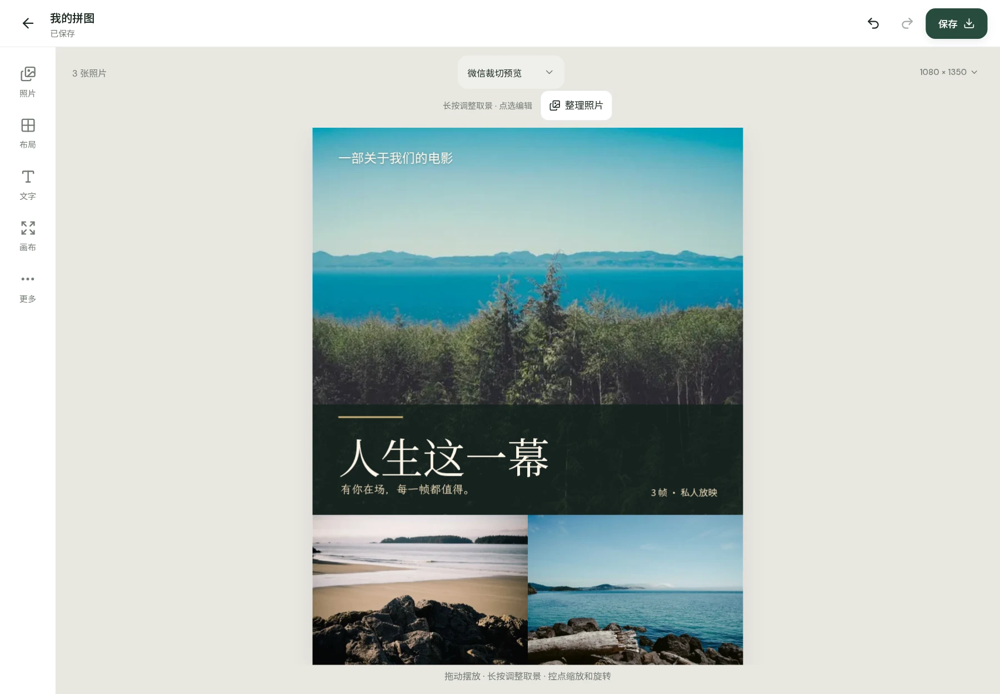
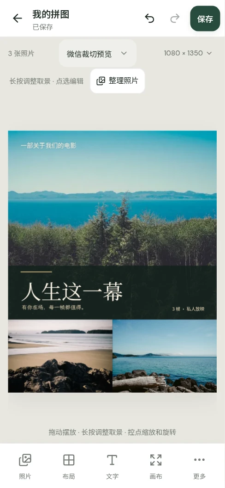

<div align="center">


# 拼贴时光 · Collage Studio

**把喜欢的瞬间，拼成一张。**

中文优先的照片拼图应用。照片、草稿与导出在设备本地处理；无需注册，不加水印。

[在线体验](https://collage.szlh.top/) · [GitHub 源码](https://github.com/jeasoncc/collage-studio) · [快速开始](#快速开始) · [原生应用](#原生应用) · [Linux 分发](#linux-分发) · [许可与素材](#许可与素材)

</div>

---


<p align="center"><sub>实际 Web/PWA 界面；示例摄影保留原作者与 Unsplash 许可。</sub></p>


## 从照片，到一张作品

1. **选照片**：一次选择 1–20 张，长按照片直接拖动；选择模式、全选与批量删除，确认前不改变作品。
2. **挑排版**：网格、原比例长图或自由拼贴；用自己的照片预览构图、密集海报与节日模板。
3. **写一句话**：添加可编辑中文题字、字体搭配、贴纸与装饰；在照片上长按调整取景。
4. **保存，再继续**：先预览 PNG / JPG / WebP，或备份完整 `.collage` 项目。草稿自动留在本机。

### 不是把照片摆进空白框

| 能力 | 实际内容 |
| --- | --- |
| 照片拼图 | 1–20 张照片；123 种构图；网格、原比例长图、自由拼贴；照片比例推荐与真实预览 |
| 密集照片海报 | 保留电影、杂志、应援、书意、纪念设计，增加 6 种佛教道场海报；1–20 张照片全部保留，中文文字与装饰叠在照片上；主图可换、文案可改 |
| 中国节日 | 春节、元宵、清明、劳动节、端午、儿童节、七夕、中秋、国庆、重阳、元旦；58 个可编辑模板包含 11 个节日设计 |
| 佛教道场 | 法会、佛诞、共修、供灯、禅修、法喜庆典；朱红、暖金、橙金与珊瑚色；6 个竖版、横版和方形模板，以及适配当前照片数量的 6 种密集海报 |
| 照片与文字 | 取景、缩放、旋转、翻转、滤镜；真实自托管中文字体、字样与衬底；可撤销、可重做 |
| 色块与形状 | 矩形、圆形、爱心、星形可新增、删除、改填充和描边颜色，调整宽高及不透明度；锁定保护、删除撤销与重做；模板装饰也可编辑 |
| 多页作品 | 新增、复制、排序与删除确认；页面可单独导出、全部打包或合成动画 |
| 媒体 | 本地 HEIC/HEIF 转 PNG、GIF 动画；视频与背景音乐；设备能力允许时导出 GIF、MP4、WebM |
| 本机抠图 | MODNet 人像与 U²-Netp 通用主体模型；首次下载模型，在本机推理，不上传原照片 |
| 离线与恢复 | Web/PWA 离线资源与本机草稿；原生应用内嵌前端资源；可编辑项目备份与导入 |

海报以紧密拼接为默认，不自动加相纸大留白。为填满照片区域会裁切照片，可重新取景；原比例长图不按海报裁切。普通风格的相框、间距、圆角与留白仍可由你调整。

大尺寸静态照片使用最长边不超过 1280 px 的编辑预览，海报方案使用缩略图，滤镜缓存按显示尺寸分配。导出按所需像素逐张读取原图，草稿缩略图不再创建整张大画布；原始文件仍用于草稿和 `.collage` 备份，不被预览缩图覆盖。单页仍支持最多 20 张照片。

**修改海报色块**：打开「更多 → 形状与涂鸦」新增矩形；点选形状后用画布上方的「编辑形状」修改颜色、描边、宽高与不透明度，或直接删除。被其他元素遮住的模板矩形，可在「更多 → 图层管理」中选中后修改；已锁定的形状需先解锁。

**使用道场主题**：在「布局 → 照片海报 → 佛教道场」为当前全部照片选择海报；或在首页「模板 → 佛教道场」选择不同横竖比例、1–6 张照片的模板。标题、题签、莲瓣和灯盏均为可编辑图层。

## 实际界面

<table>
  <tr><th>桌面 · 中文电影海报</th><th>移动视口 · 同一张作品</th></tr>
  <tr>
    <td width="72%"></td>
    <td width="28%"></td>
  </tr>
</table>

真实在线 Web/PWA 截图，移动图为 390px 浏览器视口。不是设计稿，也不冒充 Android/iOS 真机或已构建的原生应用截图。

## 快速开始

### 直接使用

打开 **[collage.szlh.top](https://collage.szlh.top/)**，选择照片即可编辑。

- 联网等待首页显示 **「离线已就绪」** 后，可断网使用核心编辑器与内置素材。AI 模型首次仍需联网下载。
- 支持安装的浏览器使用「安装应用」；iPhone/iPad 的 Safari 可通过「分享 → 添加到主屏幕」安装 PWA。
- 更新已安装的 PWA：回首页点 **「更新并刷新」**。不要通过清除站点数据更新，草稿就在本机。

### 本地开发

需要 [Bun 1.4.2+](https://bun.sh/)、Node 22+，以及源代码编译工具：Bash、Python 3、curl、tar、gzip/xz、CMake、make、pkg-config、autoconf、automake、libtool、patch。

```sh
git clone https://github.com/jeasoncc/collage-studio.git
cd collage-studio
bun install --frozen-lockfile
bun run dev
```

开发入口为 **http://127.0.0.1:5178**，端口占用时直接报错，不自动换端口。

首次开发/构建会安装固定版本 Emscripten 4.0.9，并从已锁定与校验的源码编译 HEIC/AAC。后续根据来源和输出哈希复用产物；不使用来源版本不明的内嵌 WASM。

HEIC 使用显式 C ABI；随源码分发的 libheif 补丁移除未使用的 Embind 注册。libde265 明确按 WebAssembly 交叉编译，避免构建时尝试运行 WASM 可执行文件。

```sh
bun run test
bun run build
bun run preview
```

`build` 先确认源码构建的媒体库，再运行 Vue/TypeScript 检查并输出 `dist/`。普通开发与构建不启用 PWA；发布 PWA 使用唯一版本 ID：

```sh
COLLAGE_PWA_BUILD_ID="$(date -u +%Y%m%dT%H%M%SZ)" bun run build --base=/
```

用 HTTPS 静态服务器托管 `dist/`，正确提供 JS、字体与 WASM MIME。不存在的静态资源应返回 404。编辑导航采用 `#/edit/<项目 ID>`，不需要把缺失资产伪装为首页。

项目中的 Bun/Hono 服务只提供静态文件与 `GET /api/health`，不是账号或上传后端；不运行它也可以使用静态站与原生应用。

## 原生应用

使用 **[Tauri 2](https://v2.tauri.app/)** 包装同一编辑器，目标为 **Linux、Android、iOS**。应用内嵌本地前端、字体和素材，不打开一个远程网页，不启动本地 HTTP 服务。

- 应用标识：`top.szlh.collage`；Linux 可执行文件：`collage-studio`。
- 原生构建输出 `dist-native/`，与 Web/PWA 的 `dist/` 分离；原生不注册 Service Worker，不显示 PWA 安装/更新按钮。
- 图片、视频、ZIP 和 `.collage` 经原生文件保存流程写入所选位置。Android 使用系统文件创建器；iOS 导出实际生成的文件，而不是先交付空文件；取消不会显示「已保存」。
- 文件权限只覆盖本次选择/导出的文件；不申请任意目录或 shell 权限。外部 HTTPS 链接打开系统浏览器，远程页面不获得应用 IPC。
- 原生 ONNX 执行脚本和 WASM 随应用打包；模型数据首次从 Hugging Face 下载，照片不上传。

### Linux

按 [Tauri 官方依赖说明](https://v2.tauri.app/start/prerequisites/#linux) 安装 GTK 3、WebKit2GTK 4.1、OpenSSL、librsvg 等开发依赖，并安装 Rust 1.94.1。

Ubuntu 24.04 示例：

```sh
sudo apt-get install build-essential pkg-config curl unzip libssl-dev \
  libgtk-3-dev libwebkit2gtk-4.1-dev libayatana-appindicator3-dev \
  librsvg2-dev patchelf cmake autoconf automake libtool python3 xz-utils patch
bun install --frozen-lockfile
bun run native:dev
bun run native:build --no-bundle -- --locked
```

原生开发端口为 **5220**。正式包内嵌资源，不依赖该开发服务器。Rust 构建产物在 `src-tauri/target/release/`；只通过 AUR 与 Snap Store 分发，不另外发布 Debian 包、AppImage 或独立 Linux 二进制下载。

若 Linux 窗口空白且日志出现 `Failed to create GBM buffer`，可为该应用单独设置 WebKit 兼容参数；不修改全局桌面配置：

```sh
WEBKIT_DISABLE_DMABUF_RENDERER=1 collage-studio
```

### Android

需要 Java 21、Android SDK 36、Build Tools 36.0.0、Command-line Tools 与 NDK **27.2.12479018**。按 [官方说明](https://v2.tauri.app/start/prerequisites/#android) 设置 `JAVA_HOME`、`ANDROID_HOME`、`NDK_HOME`。

```sh
rustup target add aarch64-linux-android x86_64-linux-android
bun run native:android:init --ci --skip-targets-install
bun run native:android:dev
bun run native:android:build --debug --target aarch64
```

调试 APK 可用于本机安装验收；对外发行使用自己的密钥签名，不能把调试包说成已上架产品。原生 CI 提供 APK/AAB 构建，正式签名读取明确配置的密钥秘密，不在仓库保存签名材料。

本地正式签名使用外置密钥文件及四个环境变量：`COLLAGE_ANDROID_KEYSTORE`（绝对路径）、`COLLAGE_ANDROID_STORE_PASSWORD`、`COLLAGE_ANDROID_KEY_ALIAS`、`COLLAGE_ANDROID_KEY_PASSWORD`。密钥和密码不得提交到仓库；配置完整后执行：

```sh
bun run native:android:build --apk --aab --target aarch64 --ci
```

未配置外置密钥时，正式构建输出未签名包。CI 则从 `ANDROID_*` Secrets 读取密钥，对实际 APK/AAB 单独签名并验证；两种方式都需要自己的真实发行密钥。

### iOS

**需要 macOS、完整 Xcode 与 iOS SDK；不能在 Linux 上完成 iOS 原生构建。** 应用最低 iOS **16.4**，与内嵌 AAC/ONNX 的 WebAssembly SIMD 能力一致。CI 固定使用 Xcode 26.3 / iOS 26.2 SDK，满足 [Apple 当前要求](https://developer.apple.com/news/upcoming-requirements/)的 Xcode 26+ 与 iOS 26 SDK+；最低运行版本与构建 SDK 版本是两回事。

```sh
rustup target add aarch64-apple-ios aarch64-apple-ios-sim
bun run native:ios:init --ci
bun run native:ios:dev
bun run native:ios:build --debug --target aarch64-sim --no-sign --ci
```

最后一条生成模拟器应用，不是可以装到 iPhone 的 IPA。真机/发行构建需要自己的 Apple 团队、证书及描述文件；CI 的签名流程只在显式提供这些条件时运行。没有伪造团队 ID、证书或商店发布状态。

构建与签名流程见 [native.yml](.github/workflows/native.yml)。平台工程支持不等于实体手机验收；具体运行边界见下文。

## Linux 分发

当前目标只有 **AUR（yay）** 与 **Snap Store**。构建包、登记渠道、实际发布是不同步骤；未完成账户授权与上传前，不宣称渠道已上架。

### AUR / yay

[Linux 发布流程](.github/workflows/linux-release.yml) 从 `v1.0.0` 标签产生完整源码归档、对应源码材料、Snap 和带真实 SHA-256 的 AUR 材料；Linux 构建产物不另设下载渠道。

`generate-aur.mjs` 的必填参数是**实际公开仓库的 `OWNER/REPO`**，不是 URL；它必须能下载该仓库的真实源码发布资产。运行方式与错误说明：

```sh
node scripts/generate-aur.mjs --help
```

生成目录为 `packaging/aur/collage-studio/`，包含 `PKGBUILD`、`.SRCINFO` 和归档 SHA-256。可先审阅并在本机安装：

```sh
cd packaging/aur/collage-studio
yay -Bi .
```

注册 AUR 账户及 SSH 公钥，将材料提交到实际 AUR 包仓库后，用户才可执行：

```sh
yay -S collage-studio
```

源码构建使用冻结的 Bun/Cargo 依赖；安装包含可执行文件、桌面启动器、图标与许可。不要将源码校验改为 `SKIP`。

### Snap Store

[Snap 配置](snap/snapcraft.yaml) 使用 `core24`、GNOME 桌面 SDK 与 strict confinement，不包含后台守护进程。

在有 Snapcraft 8+、已初始化 LXD 的构建环境执行：

```sh
bash scripts/build-snap.sh
sudo snap install --dangerous out/snap/collage-studio_1.0.0_amd64.snap
```

外接存储为可选手动连接，不默认授予：

```sh
sudo snap connect collage-studio:removable-media
```

正式上传需要 Ubuntu One/Snap Store 开发者账户和应用名所有权。发布流程通过 `snap-store` GitHub Environment、受限的 `SNAPCRAFT_STORE_CREDENTIALS` 与显式手动输入控制，未配置凭据时不会伪造上传成功。

## 本地数据与隐私

**没有注册登录、云同步、照片上传或使用统计后台。** 本轮不引入账号系统。

- 草稿与素材保存在当前浏览器/原生应用的本地存储中；Web/PWA 与原生应用、不同设备、域名和端口不会自动共享草稿。
- 使用「保存可编辑项目」或「更多 → 备份项目」导出 **`.collage`**，再在另一端通过「导入项目文件」恢复。
- `.collage` 是包含页面清单、原始素材副本及 SHA-256 校验的 ZIP；校验保证完整性，不是加密或数字签名。请像保护私人相册一样保护该文件。
- PNG/JPG/视频不保留可编辑图层。卸载应用、清除数据、浏览器回收存储或存储不足，都可能丢失草稿；自动保存不能代替独立备份。
- 模型下载向模型提供方发送网络请求，但原照片与推理输入留在本机。模型权重不预装，下载及缓存可能失败。

## 验证边界与实际限制

| 项目 | 边界 |
| --- | --- |
| 照片 | 单素材最多 150 MiB、6000 万像素；主体抠图输入最多 2000 万像素 |
| 项目 | 最多 100 页、2000 个素材；总素材最多 512 MiB；编辑清单最多 8 MiB |
| 导出 | 最长边 8192 px、最多 6400 万像素；设备内存可能更早耗尽 |
| 动画 | 最长 120 秒；GIF 为 256 色、没有音轨；视频需设备实际编码能力 |
| HEIC | 转为 PNG；多图 HEIC 读取第一张顶层图片，不悄悄生成空结果 |
| 视频 | MP4 为 H.264/AAC；WebM 为 VP8/VP9 与 Opus；不支持时明确报错，不无提示换格式或删音轨 |
| 字体 | 内置字体自托管；系统字体/回退字体跨设备不保证逐像素一致 |

现有回归覆盖照片分区与容量、密集海报与主图切换、裁剪与样式、撤销/恢复、项目校验及导入保存。浏览器移动视口不是实体手机；源码/CI 支持也不是商店审核或真机安装证明。未实际运行的平台、系统键盘、系统分享和相册保存不能据此宣称已验证。

## 技术结构

```text
src/                 Vue 编辑器、画布、模板、本机存储与媒体服务
src-tauri/           Rust 外壳、最小权限、Android/iOS 原生文件保存
third_party/codecs/  固定来源、许可证、HEIC/AAC 桥接与重新组合材料
scripts/             源码媒体库构建、许可材料、AUR 与 Snap 打包
snap/                严格隔离的 Snap 配置
packaging/           Linux 启动器与渠道材料
```

Vue 3 / TypeScript / Pinia 构建界面；Konva 负责画布；Dexie 负责本机存储；Zod / fflate 负责项目校验与打包；Mediabunny 负责音视频；Transformers.js / ONNX Runtime 负责本机模型推理；Tauri 2 负责原生运行与文件操作。

## 许可与素材

原创应用代码、界面和原创模板采用 **[MIT](LICENSE)**。`package.json` 的 `private: true` 仅防止误发布 npm 包，不表示 GitHub 仓库必须私有。

第三方内容保持各自许可，**不是整包统称 MIT**：

- 自托管字体：OFL-1.1，保留作者、完整原文及保留名称规则。
- Fluent Emoji：Microsoft MIT 美术许可；Lucide 还包含 ISC/Feather 条款。
- Mediabunny/AAC 桥接：MPL-2.0；FFmpeg 7.1.1：LGPL-2.1-or-later。
- libheif 1.19.8 / libde265 1.0.16：LGPL-3.0-or-later；Emscripten 及运行库保持原许可。
- 示例摄影：Paul Jarvis / Unsplash，经 Lorem Picsum 提供；适用 [Unsplash License](https://unsplash.com/license)，**不是 CC0**，也不作为可独立销售的照片素材库。

摄影来源：[森林](https://unsplash.com/photos/6J--NXulQCs) · [海岸](https://unsplash.com/photos/I_9ILwtsl_k) · [山海](https://unsplash.com/photos/gkT4FfgHO5o)。

完整原文与归属见 [第三方通知](public/third-party-notices.txt)；精确来源哈希、构建/重新组合方式见 [源码分发说明](third_party/codecs/DISTRIBUTION.txt) 和 [来源锁](third_party/codecs/sources.lock.json)。

**分发二进制时必须同时提供实际对应材料**：

```sh
bun run license:release out/source-materials
```

该命令校验已构建输出与源代码哈希，再产生 `collage-studio-codec-corresponding-source.tar.gz` 及 `.sha256`。每个 Web/Android/iOS/Linux 二进制发行都应附上该材料与精确对应的完整应用源码；普通上游链接不能替代对应源码、重新链接材料或用户修改权。未完成这一步，不把产物描述为可公开分发。
